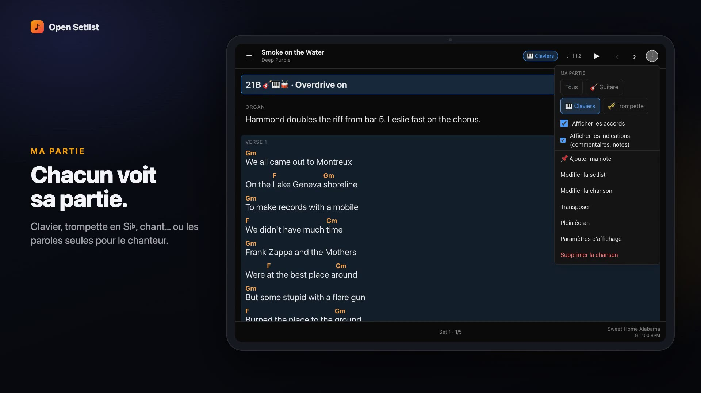

# Open Setlist

The setlist manager for small bands and orchestras. Song charts, setlists and stage mode — in the browser, offline, shared with your band.

**Try it:** https://parriauxmaxime.github.io/open-setlist/ (a demo profile with songs and setlists is preloaded)

[](docs/media/open-setlist-demo.mp4)

*70-second tour, recorded on the real app in tablet mode (French UI).*

Your data stays on your devices. No account, no subscription, no lock-in.

## Why

Every setlist app is closed-source, locked to a platform, or paywalled — and the "one click sync" of the popular ones sometimes deletes the band's source of truth. Musicians deserve a tool they actually own.

- **You own your data.** Everything lives in your browser's IndexedDB. Export whenever you want, in plain ChordPro and JSON.
- **Free and open-source.** No premium tier, no ads, no tracking.
- **Works offline.** Install it once as a PWA; it opens cold at a venue with no network.
- **Granular, not bloated.** Per-musician views, readiness, private notes — without turning into band-management software.

## Features

**Charts**
- **ChordPro editor** with live metadata sync (title, artist, key, BPM, duration, tags, notes)
- **Band conventions rendered faithfully** — setup line banner (patch codes, instruments, capo), inline cues `{comment}`, highlighted backing vocals `{soh}…{eoh}`, chorus recall (`{chorus}` or an empty chorus), tab blocks
- **Per-instrument parts** — `for=guitar`, `for=keys`… each musician picks "My part"; lyrics-only mode for singers; B♭/E♭/F horns read chords and keys at their written pitch
- **Notation** — English (C D E), solfège (Do Ré Mi) or German (H); key-aware transposition, capo display
- **Paste any chart** — chords written above lyrics (websites, PDFs) are converted to ChordPro, with title/key/capo detection
- **Live session** — optional: one device leads and the others follow its song changes; off by default
- **Sheet music** — attach PDFs or images to a song, one per instrument if needed; each musician reads their own on stage
- **Import files** — `.cho`, `.chopro`, `.crd`, `.pro`, `.txt`, several at once (multi-song files split)
- **Chord diagrams** — guitar, piano, ukulele, bass; 20 chord types; `{define}` custom shapes
- **Song lookup** — search by title, metadata from iTunes, chords from Ultimate Guitar

**Setlists**
- **Setlist builder** — multiple sets, drag and drop, durations vs expected show length
- **My notes** — private per-song reminders on your device, shown on stage, never shared
- **Readiness** — mark songs to learn / rehearsing / ready / retired; setlists warn about unready songs
- **Print / PDF** — big-font stage sheet for the floor, chart booklet as a paper backup

**On stage**
- **Performance mode** — swipe or pedal between songs, per-song zoom, chord diagrams on tap
- **Hands-free** — Bluetooth pedals (Page Up/Down, arrows, space), per-song auto-scroll, screen stays awake, fullscreen
- **Tempo** — BPM pulse, click and count-in; next song's key, tempo and setup shown in the footer

**Band**
- **Band code** — one musician creates the band, the others join with a link or a code: no account, end-to-end encrypted
- **Sync** through the band code, a GitHub repo or Google Drive — review incoming/outgoing changes, per-song conflict resolution, deletions that never silently win
- **Safe invites** — passphrase-encrypted invite links, or links without any token
- **Coming from Setlist Helper?** Import your catalog CSV and your setlist CSVs (Sync page). Keys in solfège (`RÉm`) are converted, your comments and highlights are kept.

## Install

Open Setlist is a web app. Open the URL in any modern browser and you're done.

To install it for offline use:

- **iOS** — open in Safari, tap Share, then "Add to Home Screen"
- **Android** — open in Chrome, tap the menu, then "Install app"
- **Desktop** — click the install icon in the address bar (Chrome / Edge)

It now lives on your home screen, launches like a native app, and works without internet.

## Contributing

### Prerequisites

- Node.js 18+
- Yarn

### Run locally

```bash
git clone <repo-url>
cd open-setlist
yarn install
yarn dev
```

Opens at `http://localhost:3000`.

### Commands

| Command | What it does |
|---|---|
| `yarn dev` | Dev server on :3000 with hot reload |
| `yarn build` | Production build to `dist/` |
| `yarn lint` | Biome lint + format check |
| `yarn format` | Auto-fix lint and formatting |

### Project structure

```
src/
  domain/           Business logic — music theory, ChordPro parser, validation schemas, sync, importers
  db/               Dexie (IndexedDB) schema and data interfaces
  modules/          Feature modules, each owns its page and components
    catalog/          Song listing and search
    editor/           Song creation and editing
    setlist/          Setlist management
    performance/      Stage performance view
    chords/           Chord reference
    settings/         User preferences
    sync/             Data export/import
    design-system/    Shared form components, data table
    shared/           Layout, navigation
  router.ts         Route definitions (Chicane)
  app.tsx           Root component
worker/             Cloudflare Worker: CORS proxy for song lookup + band sync relay
```

### Stack

| What | Choice |
|---|---|
| UI | React 19, TypeScript |
| Styling | Tailwind CSS v4, hand-rolled components |
| Forms | React Hook Form + Zod |
| Local DB | Dexie (IndexedDB) |
| Router | Chicane |
| Tables | TanStack Table |
| Bundler | Rspack |
| Linter | Biome |

No component library. No backend. Everything runs in the browser.

### Cloudflare Worker: lookup proxy and band relay

One small Cloudflare Worker (`worker/`) does two jobs:

- **CORS proxy for song lookup.** Ultimate Guitar doesn't serve CORS headers, so the worker forwards those requests and adds `Access-Control-Allow-Origin: *`. No parsing, no storage.
- **Band relay** (routes under `/bands/`). Stores one encrypted snapshot per band for the "Create a band / Join a band" sync. It only ever receives ciphertext, see [docs/SYNC.md](docs/SYNC.md).

To deploy your own:

1. Create a free account at [Cloudflare](https://dash.cloudflare.com/sign-up) (no credit card)
2. Install the CLI: `npm install -g wrangler`
3. Authenticate: `wrangler login`
4. In `worker/wrangler.toml`, set `ALLOWED_ORIGINS` to the address your app is served from
5. Deploy:
   ```bash
   cd worker
   wrangler deploy
   ```
6. Paste the printed URL into `src/modules/lookup/adapters/proxy.ts` (lookup), and build the app with the same URL in the `RELAY_URL` environment variable (band sync). The GitHub Pages workflow reads it from the repository variable `RELAY_URL`; locally, put it in `.env`.

Without `RELAY_URL` the app still works: the Sync page says band sync is not switched on.

Free tier covers 100K requests/day (a sync is about four) and 5 GB of Durable Object storage. The proxy is only hit when importing chords — metadata comes directly from the iTunes Search API, which supports CORS natively.

To try the relay locally: `cd worker && npx wrangler dev --port 8787`, then `RELAY_URL=http://127.0.0.1:8787 yarn dev`.

### Conventions

See [`CLAUDE.md`](CLAUDE.md) for coding conventions, file organization rules, and architectural decisions.

## License

MIT
